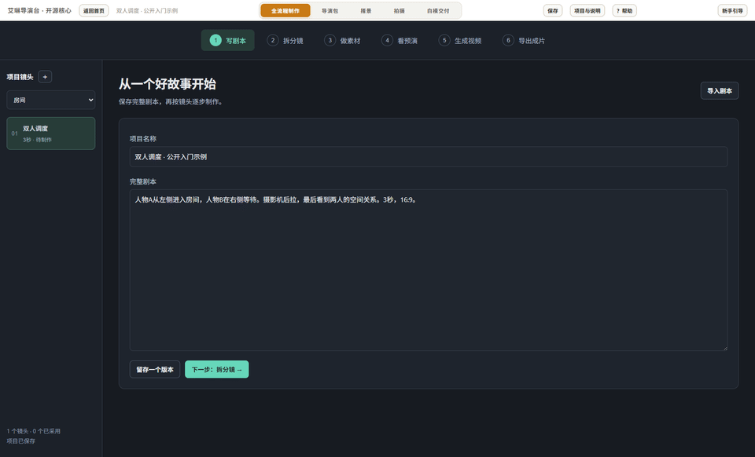

# 艾琳导演台

**简体中文** | [English](README.en.md)

从剧本到分镜、素材、白模预演与视频成片的桌面工作台。适合短剧、漫剧及 AI 视频制作，把每个镜头的描述、参考素材和生成版本放在同一个项目里管理。

**当前版本：0.3.0-alpha.1 开发版 · Windows x64**

[下载 Windows EXE](https://github.com/liutongxian/ailin-director-previs/releases/download/v0.3.0-alpha.1/AilinDirectorPrevis-0.3.0-alpha.1-win-x64.exe) · [发布说明与校验值](https://github.com/liutongxian/ailin-director-previs/releases/tag/v0.3.0-alpha.1) · [全流程使用说明](docs/全流程制作.md)



*公开虚构示例的真实界面录屏式预览；生成视频页面展示输入设置，不代表已生成云端成片。*

## 不用 API Key，先体验一个项目

[下载公开示例 ZIP](https://github.com/liutongxian/ailin-director-previs/releases/download/v0.3.0-alpha.1/ailin-quickstart.zip) · [示例说明](examples/quickstart/README.md)

解压后，进入“开始全流程制作” → “项目与说明” → “打开项目”，选择 `Quickstart.blockout` 文件夹。里面已准备一段虚构剧本、一个可编辑镜头和三项资产需求与提示词，可以直接查看和修改，不必先配置模型。导出白模需要 FFmpeg；云端生成需另行配置自己的账户。

## 一套连贯的制作流程

| 步骤 | 能做什么 |
| --- | --- |
| 写剧本 | 输入或导入剧本，保存不同版本 |
| 拆分镜 | 调用自己的文字模型拆镜，整理人物、场景、道具及图片提示词，也可手动编辑 |
| 做素材 | 导入或生成资产图片，保留候选版本，选定后关联到对应镜头 |
| 看预演 | 编辑人物、道具、走位与摄影机，用 Three.js 或 Blender 导出白模参考视频 |
| 生成视频 | 逐镜选择模型、提示词、参考图片/视频/音频，查询任务、下载并采用生成版本 |
| 导出成片 | 合并采用的镜头、裁剪首尾、添加配乐，输出 MP4 和独立 SRT 字幕 |

原有的导演包导入、手动搭景、镜头调度与新手气泡引导继续保留。导演包支持 `.ailin.json` 和带素材的 `.ailinpack`，可由外部 Agent 按软件提供的格式生成。

## 模型与参考素材

- **拆镜**：支持 DeepSeek 等兼容 Chat Completions 的文字模型，填写自己的服务地址和模型名称。
- **图片**：提供火山方舟 Seedream、MiniMax Image-01 入口，以及本地 Unsloth Studio / Qwen-Image 2.1 接口。
- **视频**：提供 MiniMax H3、火山方舟 Seedance、BytePlus LAS Seedance 适配，包含 Seedance 2.5 预设。
- **参考素材**：每个镜头单独选择人物图、场景图、首尾帧、动作视频、机位参考或音频；具体类型和数量受模型能力限制。部分云端视频参考需填写可访问的素材地址。

模型账户、权限和额度需要自行准备。预设不保证账户已开通；不同接口协议的新供应商需要增加适配器。本地 Qwen 需要先在 Unsloth Studio 中安装并加载模型。

## 下载与运行

1. 从上方链接下载 EXE；这是 **免安装便携版**，双击即可运行。
2. 在首页选择“开始全流程制作”，或进入原有导演包 / 手动搭景工作区。
3. 导出视频需安装支持 H.264 的 FFmpeg / FFprobe；Blender 高级白模还需安装 Blender。它们未包含在 EXE 中。
4. 在对应页面填写自己的 API Key，或使用已配置的本地模型。

Windows 程序暂未进行代码签名。可用发布页的 `SHA256SUMS.txt` 核对下载文件。旧版项目建议先复制备份，再用开发版打开。

如果软件找不到渲染工具，可以在 PowerShell 设置路径后启动：

```powershell
$env:AILIN_BLENDER = 'C:\Program Files\Blender Foundation\Blender 5.2\blender.exe'
$env:BLOCKOUT_FFMPEG = 'C:\ffmpeg\bin\ffmpeg.exe'
.\AilinDirectorPrevis-0.3.0-alpha.1-win-x64.exe
```

## 数据与密钥

项目、素材、生成记录与输出保存在本机。点击云端生成时，剧本或所选参考素材会发送到对应服务商。

**仓库和安装包不包含 API Key、密码、个人项目或本机配置。** 生图、生视频密钥与本地服务密码仅在运行期间使用，不写入项目。程序不自动读取任意 `.env` 或机器上的密码文件。不要把凭据填进提示词、项目名称或服务地址。

## 当前验证范围

类型检查、代码检查、构建、1074 项单元测试及 9 项 Electron 流程测试通过。自动化云端流程使用模拟响应；本机 FFmpeg 合并、字幕时间及工程迁移重开实际执行。

DeepSeek 已完成实际拆镜。MiniMax 图片与 H3 的真实生成仍受测试账户余额限制；本地 Qwen 已完成连接检查，真实出图尚受运行环境限制；Seedance 尚未完成真实账户生成验收。当前版本适合体验与继续验证，不能视为短剧全流程制作已全部验收。详细边界见[全流程说明](docs/全流程制作.md)。

## 从源码运行

需要 Node.js 22.12+：

```powershell
git clone https://github.com/liutongxian/ailin-director-previs.git
cd ailin-director-previs
npm ci
npm run dev
```

```powershell
npm run typecheck
npm run lint
npm test
npm run package:win
```

便携 EXE 输出到 `release-open-core/`。开发接口见 [MCP/CLI](mcp/README.md)，导演包教程见[从导演包到白模视频](docs/从导演包到白模视频.md)。

## 来源与许可

基于 Sam Wasserman 的 [Blockout](https://github.com/wassermanproductions/blockout) 改造，采用 Apache-2.0。保留原作者版权和署名，详见 [LICENSE](LICENSE)、[NOTICE](NOTICE) 与 [MODIFICATIONS.md](MODIFICATIONS.md)。
