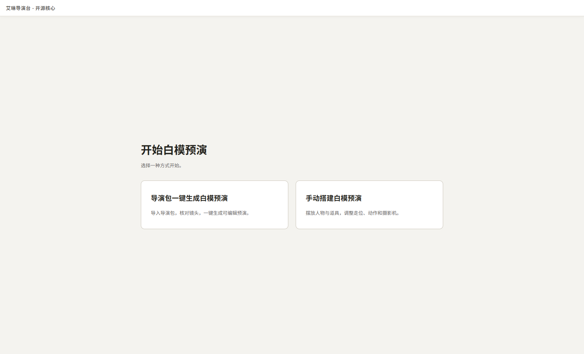
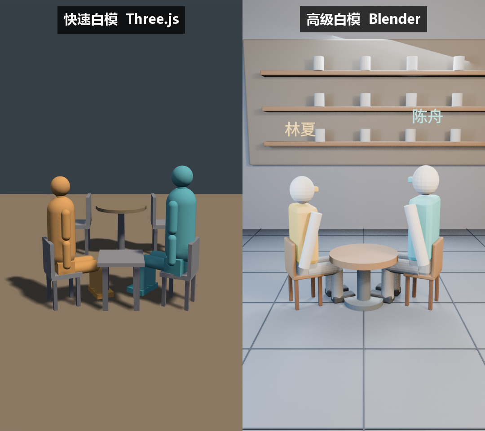
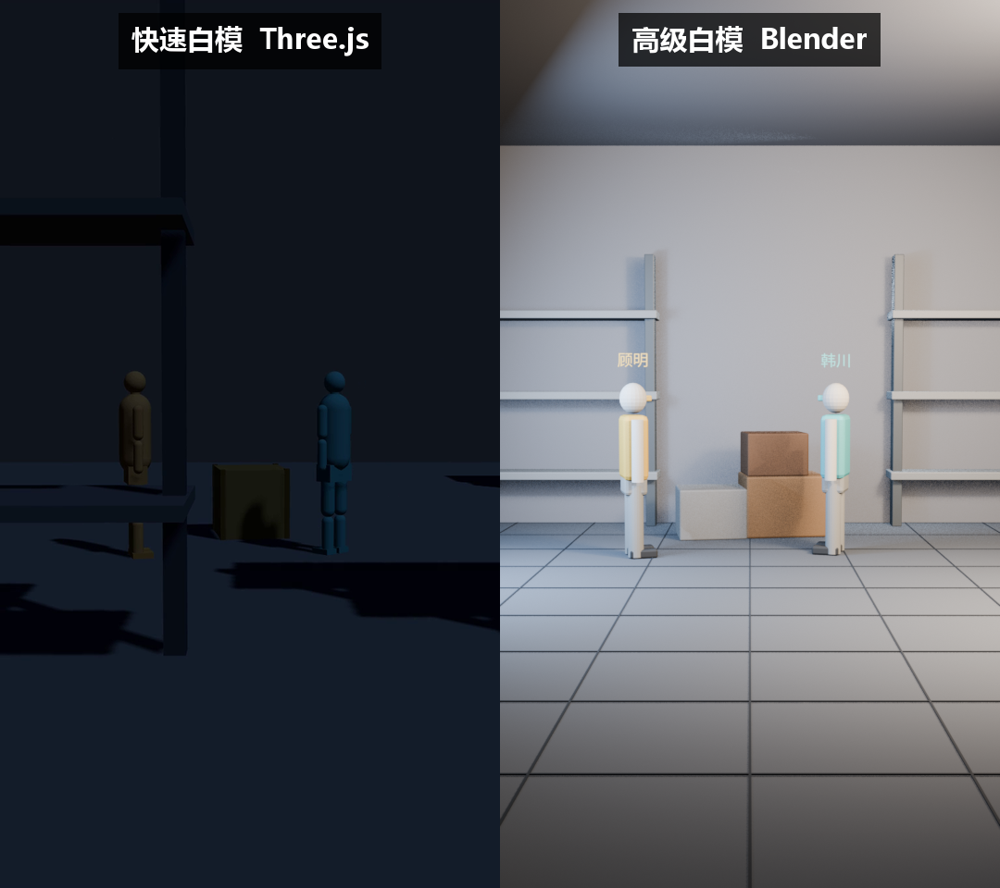
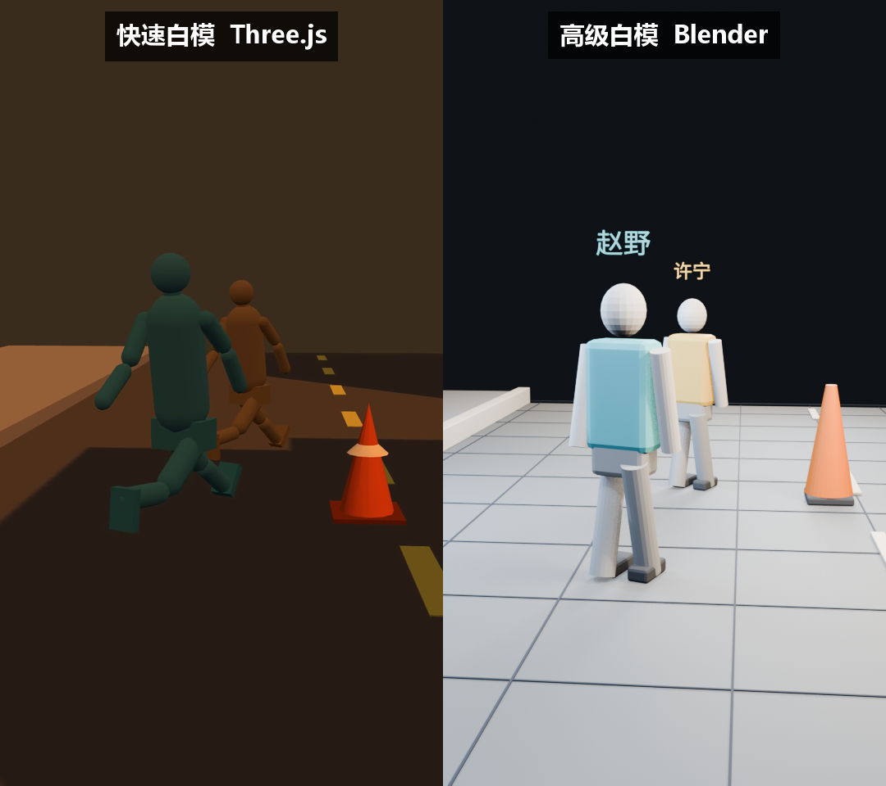

# 艾琳导演台 · 开源核心

首页只保留两个入口：**导演包一键生成白模预演**、**手动搭建白模预演**。导入外部 Agent 的导演包，或自行摆放人物、道具和摄影机；完成检查后，用本机 Three.js／Blender 与 FFmpeg 导出白模 MP4。

项目基于 Sam Wasserman 的 [Blockout](https://github.com/wassermanproductions/blockout) 改造；来源与修改见 [NOTICE](NOTICE)、[MODIFICATIONS.md](MODIFICATIONS.md)。



进入后再显示对应工作区，可随时返回首页，当前项目保持原样。[查看导演包工作区](media/showcase/director-ui.png) · [查看搭景界面](media/showcase/stage-ui.png)。

## 新手气泡引导（0.2.4）

首次打开会显示右上角的新手气泡；可随时关闭，从顶栏“新手引导”重新打开，或继续上次的步骤。首页仍只有两种主要预演入口。

1. **先跑一遍示例**：为练习打开独立项目，载入软件内置的双人调度导演包，核对首中尾，生成可编辑场景、播放，再生成和保存第一条白模 MP4。不需要另外下载示例文件。
2. **制作自己的导演包**：复制标准提示词，连同自己的剧本交给外部 AI；保存其交付的 `.ailin.json` 或 `.ailinpack`，导入、核对并生成场景。软件不会自行调用模型或产生云端生成费用。
3. **生成白模视频**：选择镜头和引擎，等待真实生成完成，播放检查、打开输出位置，再保存项目。
4. **手动搭景与拍摄**：新建空白项目、放置人物道具、修改属性、添加走位、自动构图与机位点、播放和保存，再导出白模。

气泡指向实际控件，不拦截操作区；关键步骤在真实操作成功后才允许继续，也可以跳过本步。缩放窗口、滚动或切换页面时会重新定位。引导仅记忆本机进度；载入示例前检查未保存修改，拒绝切换时保留原工程。Blender 和 FFmpeg 仍需自行配置。

详情与验收范围见 [0.2.4 新手气泡引导](docs/新手气泡引导-2026-10-24.md)。此前发布的 0.2.3 EXE 不包含新增引导，请从 [v0.2.4 发布页](https://github.com/liutongxian/ailin-director-previs/releases/tag/v0.2.4) 下载新版，或从当前源码构建。

## 白模效果展示

点击预览图可看同步对比视频；也可分别打开两种引擎的原始白模 MP4。

| 通用镜头 | 同步对比视频 | 单独白模视频 |
| --- | --- | --- |
| 咖啡馆会面 · 7 秒 | [](media/showcase/cafe-compare.mp4) | [Three.js](media/showcase/cafe-threejs.mp4) · [Blender](media/showcase/cafe-blender.mp4) |
| 仓库对峙 · 8 秒 | [](media/showcase/warehouse-compare.mp4) | [Three.js](media/showcase/warehouse-threejs.mp4) · [Blender](media/showcase/warehouse-blender.mp4) |
| 街角追逐 · 6 秒 | [](media/showcase/street-compare.mp4) | [Three.js](media/showcase/street-threejs.mp4) · [Blender](media/showcase/street-blender.mp4) |

这些是三组通用案例的既有白模样片，不是随附“双人调度”入门包的输出，也不包含最终生视频模型成片。开源核心使用同一类 Three.js／Blender 白模渲染流程；可按下文教程用自己的导演包生成新视频。

## 下载与启动

Windows 用户可从 [v0.2.4 Releases](https://github.com/liutongxian/ailin-director-previs/releases/tag/v0.2.4) 下载 `AilinDirectorPrevis-0.2.4-win-x64.exe`。这是免安装版，双击运行。当前未提供代码签名，Windows SmartScreen 可能提示；请核对发布页的 SHA-256 后自行决定是否运行。EXE 不包含 Blender 或 FFmpeg。

也可以下载源码，在 Windows PowerShell 中启动完整 UI：

```powershell
git clone https://github.com/liutongxian/ailin-director-previs.git
cd ailin-director-previs
npm ci
npm run dev
```

源码运行需要 Node.js 22.12+。要导出视频，还需自行安装 [Blender](https://www.blender.org/download/) 与支持 H.264 的 [FFmpeg](https://ffmpeg.org/download.html)；Blender 高级白模需要两者，Three.js 快速白模需要 FFmpeg。若程序找不到它们，可在启动前设置绝对路径：

```powershell
$env:AILIN_BLENDER = 'C:\Program Files\Blender Foundation\Blender 5.2\blender.exe'
$env:BLOCKOUT_FFMPEG = 'C:\ffmpeg\bin\ffmpeg.exe'
npm run dev
```

使用 EXE 时，先在 PowerShell 设置上述环境变量，再从同一个 PowerShell 启动 EXE；或将 Blender、FFmpeg 加入系统 `PATH`。

## 第一次跑通：导演包到白模视频

1. 在首页选择“导演包一键生成白模预演”，点击“复制导演包完整提示词”，把它和自己的剧本／分镜交给外部 Agent。提示词包含规则、JSON Schema 和完整示例。带素材时交付 `.ailinpack`（ZIP，根目录含 `director.ailin.json` 和对应 `assetBindings`）；纯文本时交付 UTF-8 `.ailin.json`。
2. 点击“导入艾琳导演包…”，选取 Agent 的文件。先看校验结果、每镜头时长、人物与机位，以及首／中／尾摘要。首次体验可直接导入仓库的 [双人调度示例](examples/双人调度.ailin.json)。
3. 点击“一键生成全部可编辑 3D 预演”。若提示替换示例场景，确认后进入“搭景”。在“搭景”调整人物、道具、场景，在“拍摄”检查摄影机和时间线。
4. 打开“白模交付”，选择场景和镜头，选择“高级白模 Blender”，点击“生成当前Blender高级白模”。完成后播放检查，也可设为最终交付参考。多镜头项目逐镜头选择并生成。
5. 点击视频卡片中的“打开输出位置”。Blender 输出包含 H.264 MP4、可编辑 `.blend`、首／中／尾检查图和运行记录；将 MP4 提供给生视频模型作空间、走位和摄影机参考。

逐屏说明、外部 Agent 提示词用法、文件结构、常见报错与验收方法见 [从导演包到白模视频](docs/从导演包到白模视频.md)。

## 手动搭建白模预演

在首页选择“手动搭建白模预演”，进入“搭景”摆放人物与道具，再到“拍摄”调整走位、动作和摄影机，最后从“白模交付”导出 MP4。可继续当前项目；需要空白场景时，在“项目与说明”中新建项目。打开已有项目、保存和示例也在工作区内提供。

## 界面与边界

| 页面 | 用途 |
| --- | --- |
| 导演包 | 导入 `.ailinpack`／`.ailin.json`，核对镜头卡与首中尾，一键生成可编辑预演 |
| 搭景 | 修改每镜头的可编辑 3D 场景、人物、道具、位置和轨迹 |
| 拍摄 | 检查机位、摄影机运动、时间线及镜头时长 |
| 白模交付 | 按镜头运行 Three.js 或 Blender 白模，播放、打开输出目录并选定参考版本 |

本开源核心是真实 Electron 桌面程序，不是静态展示页；Blender 和 FFmpeg 均由本机进程调用。它不包含商业授权、云端生视频服务、私有素材、模型 API 密钥或完整商业管理台。白模用于运动与空间参考，不替代最终生成画面、声音及人工导演判断。所有项目与输出默认保存在本机。

## 开发与验证

```powershell
npm run typecheck
npm run lint
npm test
npm run smoke
npm run package:win
```

`npm run smoke` 在 Electron 中真实跑两条 Blender/FFmpeg 链路，其中一条从示例导演包导入开始。构建后的便携 EXE 位于 `release-open-core/`；构建者仍需自行配置 Blender 和 FFmpeg。外部 Agent 也可使用 [本地 MCP/CLI](mcp/README.md)；格式定义见 [Previs IR](previs-ir/README.md)。

本次改版与验证见 [v0.2.3 发布记录](docs/开源版简化首页-2026-10-20.md)；历史公开内容核验见 [v0.2.2 记录](docs/公开内容与可用性核验-2026-09-21.md)。

源码按 [Apache License 2.0](LICENSE) 发布；重新分发时保留原项目 [NOTICE](NOTICE)、[MODIFICATIONS.md](MODIFICATIONS.md) 和适用的 [第三方说明](THIRD_PARTY_NOTICES.md)。
